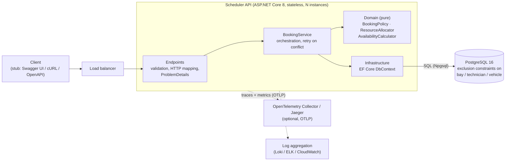
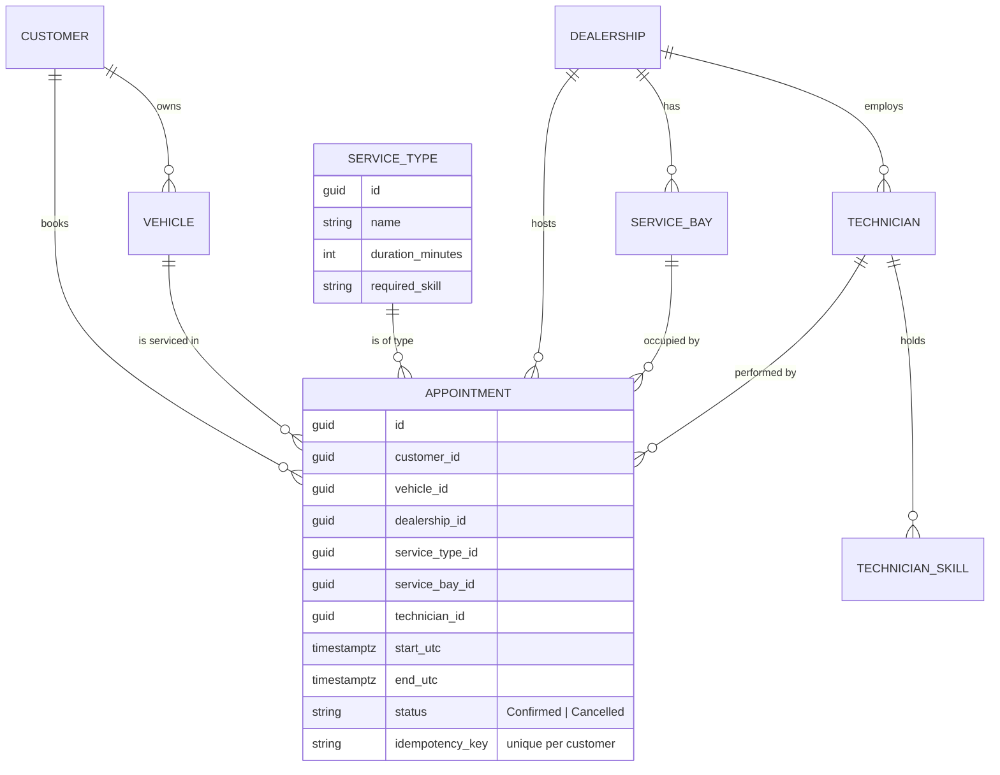
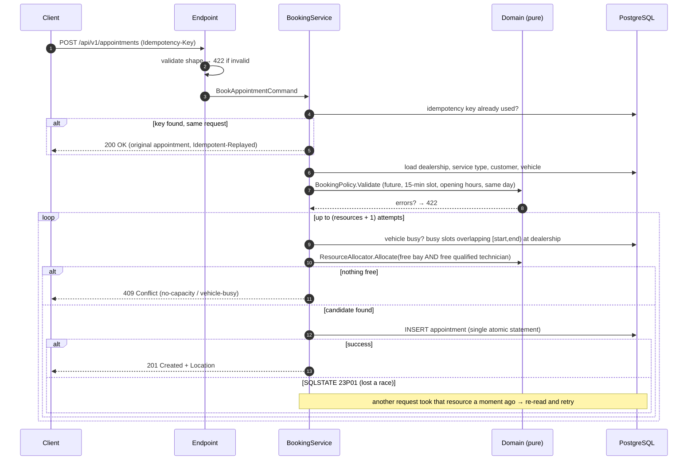

# System Design Document — Unified Service Scheduler (Scenario A)

**Domain:** Ownership · **Layer implemented:** Backend (RESTful API + PostgreSQL) · **Client layer:** stubbed with OpenAPI spec, Swagger UI and cURL examples

---

## 1. Problem and scope

Customers must be able to book a service appointment for a **specific vehicle, service type and dealership at a desired time**. A booking is only confirmed if, **for the entire service duration**, the dealership has both a free **ServiceBay** and a free **Technician qualified** for that service. On success a persistent **Appointment** links customer, vehicle, technician and bay.

The hard part is not CRUD — it is guaranteeing that two customers racing for the last slot can never both succeed, while staying fast and horizontally scalable. That drives the main design decision (§7).

**In scope:** booking, availability lookup, retrieval/listing, cancellation, idempotent retries, observability.
**Out of scope (documented as future work, §12):** authentication, customer/vehicle/dealership management APIs, rescheduling, notifications, payments.

## 2. Assumptions (the brief allows reasonable assumptions)

| # | Ambiguity in the brief | Assumption |
|---|---|---|
| A1 | What is "qualified"? | Each `ServiceType` requires one skill; a `Technician` holds a set of skills. Qualified = holds the required skill (case-insensitive). |
| A2 | Does a service use more than one bay/technician? | Exactly **one bay and one technician for the whole duration**. |
| A3 | Which time zone? | Instants are stored and exchanged in **UTC**. Opening hours are **dealership-local** (IANA zone per dealership), so DST is handled correctly. |
| A4 | Opening hours / days | Each dealership has local open/close times; closed on **Sundays**. A service must start and finish on the same local day, no later than closing time. |
| A5 | Time granularity | Start times are aligned to **15-minute slots** (configurable). Durations come from the service type. |
| A6 | Who chooses the bay/technician? | The **system** picks (deterministic: lowest bay id, technician by name). The customer only picks dealership, service, vehicle, time. |
| A7 | Buffers between appointments | None. Intervals are half-open `[start, end)`, so back-to-back bookings are allowed. |
| A8 | Can a vehicle be in two places at once? | No. A vehicle cannot have overlapping confirmed appointments (anywhere). |
| A9 | Service catalogue | Global; a dealership can perform any service it has a qualified technician for. |
| A10 | Ownership check | The vehicle must belong to the requesting customer. Real authentication is out of scope, so `customerId` is supplied in the request. |
| A11 | Cancellation | Allowed until the appointment starts. Cancelled appointments are kept (audit) but release their resources. |
| A12 | Booking horizon | Up to 180 days ahead (configurable). |

## 3. Architecture



### Component roles

| Component | Role |
|---|---|
| **Endpoints** (`Endpoints/`) | Minimal-API routes. Shape/format validation, `Idempotency-Key` header, maps domain outcomes to HTTP (201/200/404/409/422) as RFC 7807 problem details. Contains no business rules. |
| **BookingService** (`Application/`) | Use-case orchestration: load data, run policy, allocate, insert, and **retry when the database reports a lost race**. Emits traces, metrics and logs. |
| **Domain** (`Domain/`) | Pure, dependency-free business logic: `BookingPolicy` (when may a booking happen), `ResourceAllocator` (which bay + technician), `AvailabilityCalculator` (bookable slots). Pure functions → trivially unit-testable and deterministic. |
| **Infrastructure** (`Infrastructure/`) | EF Core model, idempotent schema/constraint initialiser, seed data. |
| **PostgreSQL** | System of record **and the final arbiter of consistency** via exclusion constraints. |
| **Observability stack** | Structured logs to stdout; traces/metrics via OTLP to any backend. |

## 4. Data model



Key indexes/constraints on `appointments`: `(dealership_id, start_utc)` for the busy-window query; unique `(customer_id, idempotency_key)` where key is not null; and the three exclusion constraints in §7.

## 5. Data flow — creating a booking



**Status code mapping:** `201` created · `200` idempotent replay / cancel / reads · `404` unknown dealership, service, customer, vehicle or appointment · `409` no capacity or vehicle already booked · `422` validation failure, vehicle not owned by customer, idempotency key reused with a different request.

## 6. API surface (full contract in `docs/openapi.yaml`)

| Method | Path | Purpose |
|---|---|---|
| `POST` | `/api/v1/appointments` | Book (supports `Idempotency-Key`) |
| `GET` | `/api/v1/appointments/{id}` | Fetch one |
| `GET` | `/api/v1/appointments?customerId=&dealershipId=&from=&to=&take=` | List/filter |
| `DELETE` | `/api/v1/appointments/{id}` | Cancel (idempotent) |
| `GET` | `/api/v1/dealerships/{id}/availability?serviceTypeId=&date=` | Bookable start times for a local date |
| `GET` | `/health/live`, `/health/ready` | Liveness / readiness (DB) |

## 7. Concurrency and consistency — the central decision

**Problem.** "Check availability, then insert" is a classic check-then-act race: two requests both see a free bay and both insert.

**Options considered**

| Option | Verdict |
|---|---|
| In-process lock / `lock` | ❌ Breaks as soon as there is more than one API instance. |
| `SERIALIZABLE` transactions | ⚠️ Correct, but produces serialization failures for *unrelated* bookings that merely touch the same index range; needs retry logic anyway and hurts throughput. |
| Pessimistic row locks (`SELECT … FOR UPDATE` on bays/technicians) | ⚠️ Correct, but serialises all bookings for a resource, risks deadlocks (bay + technician lock ordering), and holds locks across network round-trips. |
| Distributed lock (Redis/Redlock) | ❌ Extra moving part, weaker guarantees than the database that already holds the data. |
| **PostgreSQL exclusion constraints + optimistic retry** | ✅ **Chosen.** |

**Chosen design.** Declare the invariant in the database:

```sql
EXCLUDE USING gist (service_bay_id   WITH =, tstzrange(start_utc, end_utc, '[)') WITH &&) WHERE (status = 'Confirmed');
EXCLUDE USING gist (technician_id    WITH =, tstzrange(start_utc, end_utc, '[)') WITH &&) WHERE (status = 'Confirmed');
EXCLUDE USING gist (vehicle_id       WITH =, tstzrange(start_utc, end_utc, '[)') WITH &&) WHERE (status = 'Confirmed');
```

* The invariant holds **regardless of how many API instances, bugs, or future code paths** write to the table.
* The application still runs the allocation logic first (so the common case succeeds in one insert and users get meaningful errors), but treats the constraint as the source of truth.
* On `SQLSTATE 23P01` the service re-reads the busy set and re-allocates. Each lost race means another request just consumed a resource, so retries are bounded by *(number of resources + 1)* and can never loop forever.
* Only `Confirmed` rows participate, so **cancelling frees the slot** with no cleanup job. Half-open ranges make back-to-back bookings legal.
* A single `INSERT` is atomic, so no explicit multi-statement transaction or lock is required — contention is limited to rows for the *same* bay/technician/time.

**Verified:** the constraint SQL was executed against PostgreSQL 16 for overlap-on-bay, overlap-on-technician, overlap-on-vehicle, back-to-back, cancelled-row and re-book-after-cancel scenarios, and the violation surfaces as `23P01` (the code the retry logic matches). The test suite additionally races 4–10 simultaneous HTTP requests and asserts the exact number of winners.

**Idempotency.** Clients may retry on timeouts. A unique `(customer_id, idempotency_key)` index plus a pre-check gives exactly-once booking semantics: same key + same request → `200` with the original appointment; same key + different request → `422`. A race between two identical retries is resolved by catching `23505` and returning the winner.

## 8. Technology choices

| Choice | Why |
|---|---|
| **.NET 8 / ASP.NET Core (minimal APIs)** | LTS, high throughput, first-class async, built-in DI, health checks, ProblemDetails. Strong fit for a Keyloop-style enterprise backend. |
| **PostgreSQL 16** | Range types and **exclusion constraints** (impossible in MySQL/SQL Server/SQLite) are exactly the primitive this problem needs; `timestamptz`; mature, horizontally read-scalable. |
| **EF Core 8 + Npgsql** | Productive, typed queries, first-class PostgreSQL provider. Raw SQL only where the ORM has no abstraction (constraints). |
| **Serilog (compact JSON)** | Structured, machine-parsable logs ready for any aggregator; request logging middleware. |
| **OpenTelemetry (OTLP)** | Vendor-neutral traces + metrics; no lock-in to a specific APM. |
| **Swagger / OpenAPI** | Self-documenting contract; doubles as the stub for the not-implemented client layer. |
| **xUnit + Testcontainers** | Integration tests run against **real PostgreSQL**; mocking the database would hide precisely the behaviour (exclusion constraints) that matters most. |
| **Docker / Compose / GitHub Actions** | One-command run for reviewers; CI builds, tests and builds the image. |

## 9. Observability strategy

* **Logging.** Structured JSON on stdout (12-factor), `service` property, trace/span correlation. Request logging with latency and status. Business log line per booking (`outcome`, dealership, vehicle, start, appointment id) — no personal data (ids only). Noisy framework categories raised to `Warning`.
* **Metrics.** OpenTelemetry runtime + ASP.NET Core metrics, plus domain metrics:
  `scheduler.bookings{outcome}` (created / no-capacity / vehicle-busy / validation / replay …), `scheduler.booking.duration` (histogram, ms) and `scheduler.booking.conflict_retries` — a direct read-out of contention. Suggested alerts: `5xx` rate, p95 booking latency, sustained growth of `conflict_retries`, rising `NoCapacity` ratio (capacity planning signal).
* **Tracing.** ASP.NET Core and Npgsql instrumentation plus a custom `booking.create` span tagged with dealership, service type and outcome. A single trace shows HTTP → service → each SQL statement. Export by setting `OTEL_EXPORTER_OTLP_ENDPOINT` (Compose profile `observability` ships Jaeger).
* **Health.** `/health/live` (process) and `/health/ready` (PostgreSQL reachable) for orchestrator probes.
* **Errors.** All failures are RFC 7807 problem details carrying a `traceId` so a user-reported error maps straight to a trace.

## 10. Scalability, performance, reliability, maintainability

* **Scalability.** API is stateless → scale out behind a load balancer. Contention is naturally partitioned by dealership/resource/time, so unrelated bookings never block each other. Next steps: read replica for `availability`, short-TTL cache of availability per (dealership, service, date) with invalidation on write, table partitioning by month on `start_utc`, and (at very large scale) sharding by dealership id.
* **Performance.** Busy-window query is a single indexed range scan on `(dealership_id, start_utc)` returning only overlapping rows; allocation is in-memory over a handful of resources; booking = ~6 small queries + 1 insert. All I/O is async.
* **Reliability.** Database-enforced invariants, idempotent booking, bounded retries, readiness probes, startup DB retry loop, non-root container.
* **Maintainability.** Layered folders with a dependency-free domain core; business rules are pure functions with exhaustive unit tests; one place (`BookingService`) owns orchestration; infrastructure details are isolated.

## 11. Testing strategy

* **Unit (pure domain):** opening hours, DST, slot alignment, Sunday, horizon, half-open interval boundaries, allocation (skill, bay, technician, partial overlap, back-to-back, determinism), availability grid.
* **Integration (real PostgreSQL, full HTTP stack):** happy path and persistence, skill mismatch, overlap/back-to-back, validation (hours, past, ownership), 404, vehicle double-booking, idempotency (replay + misuse), cancellation frees capacity, availability, health.
* **Concurrency:** 10 simultaneous requests for one bay/technician → exactly 1 booking; capacity bounded by the scarcer resource; losers of a race are re-allocated rather than failed.

## 12. Risks and future work

* **Hot slots:** extreme contention on one dealership/day produces retries; metrics (`conflict_retries`) expose it; mitigate with queueing/waitlists.
* **Allocation policy:** first-free is simple and deterministic; a load-balancing or skill-seniority policy can replace `ResourceAllocator` without touching callers.
* **Schema evolution:** replace the idempotent initialiser with versioned migrations in CI/CD.
* **Not built:** authN/Z (JWT + ownership checks), rescheduling, multi-bay/multi-technician services, technician shifts/leave, notifications via a transactional outbox, rate limiting, `/metrics` Prometheus scrape endpoint.

## 13. How GenAI was used in the design phase

> **Note for the author:** this section must describe *your* real process — interviewers weigh it heavily. The factual skeleton below reflects how this design was actually produced; replace the bracketed prompts with the real ones you used and add where *you* disagreed with or corrected the AI.

**Tool:** Claude (chat) used as a design partner; code and documents were generated with its help, then reviewed and verified by me.

**What I asked the AI to do**
1. Compare the four scenarios against the evaluation criteria and recommend one (it recommended A + backend; I agreed because it has the richest consistency problem and fits my .NET/PostgreSQL experience). `[add your own reasoning/prompt]`
2. Enumerate ambiguities in the brief and propose assumptions → §2. `[mark which you changed]`
3. Generate and compare concurrency strategies (§7). I chose exclusion constraints + optimistic retry because the invariant should live in the database, not in application code.
4. Draft the architecture diagram, sequence diagram, and ER model in Mermaid so they are version-controlled text.

**How the AI output was validated** (during the AI-assisted build session)
* A review pass over the first draft found that a fixed retry count (3) would wrongly reject the 4th of 4 racing requests; the bound was changed to *resources + 1* (§7).
* The constraint SQL was executed against a real PostgreSQL 16 instance (overlap on bay / technician / vehicle, back-to-back, cancelled rows, re-book after cancel) and the `23P01` SQLSTATE was confirmed, rather than trusting the explanation.
* The pure domain logic was compiled and run against 28 assertions (including DST edge cases) before being wrapped in the API.
* `[Add: re-run these yourself on your machine (`dotnet test`, the SQL in DbInitializer.cs) and record anything that failed or that the AI got wrong — e.g. package versions, API shapes, edge cases — and what you changed.]`

**What I deliberately did not delegate:** the decision on where consistency lives, the status-code contract, and the scope boundaries.
